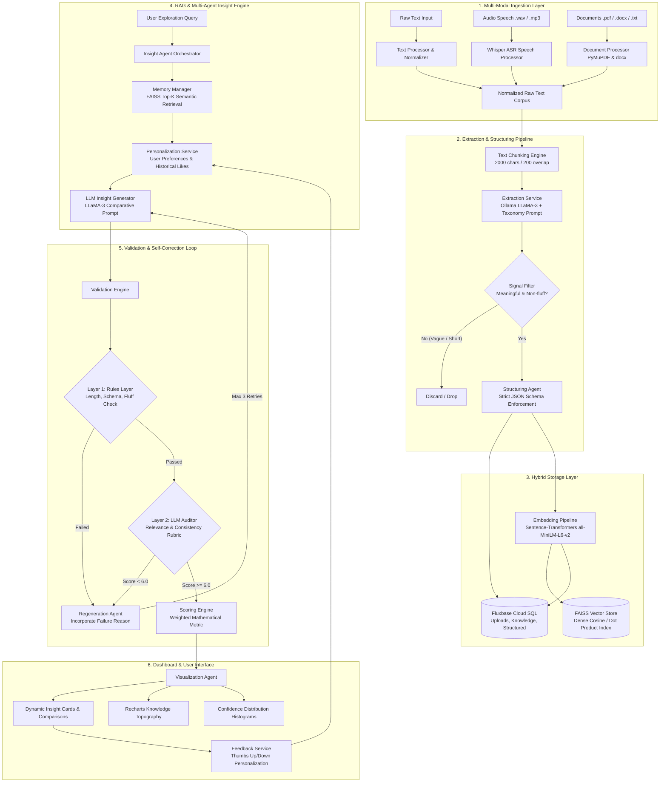

# 🌳 Intergenerational Knowledge Preservation using Agentic AI

[](https://fastapi.tiangolo.com/)
[](https://react.dev/)
[](https://ollama.com/)
[](https://github.com/facebookresearch/faiss)
[](https://fluxbase.vercel.app/)
[](https://github.com/openai/whisper)

---

## 📌 1. Executive Summary & Vision

Modern Artificial Intelligence systems excel at information retrieval, factual question answering, and high-speed text summarization. However, they frequently overlook **human wisdom, lived experiences, contextual values, and intergenerational decision patterns** that have guided societies across generations.

The **Intergenerational Knowledge Preservation Platform** is an end-to-end, multi-agent AI system architected to:
1. **Ingest and Normalize** unstructured human life stories, elder oral histories, and traditional practices across multi-modal formats (Audio Speech, PDFs/Documents, and Raw Text).
2. **Extract and Structure** nuanced life lessons into a deterministic taxonomy (Experiences, Practices, Ethics, Decision Patterns, Problem-Solving Methods, and Thought Processes).
3. **Persist Knowledge in Hybrid Storage**: Dense semantic vector embeddings in FAISS coupled with relational metadata in Fluxbase Distributed Cloud SQL.
4. **Generate Intergenerational Insights** by contrasting historical patterns against modern equivalents, identifying societal impacts, and deriving grounded, actionable life recommendations.
5. **Enforce Rigid Quality with a Multi-Tier Validation & Regeneration Loop**: Deterministic heuristic rules, LLM-based rubric auditing, and automated self-correction.
6. **Quantify Reliability** via a composite mathematical confidence scoring formula.
7. **Deliver Interactive Intelligence & Analytics** through a React dashboard with real-time feedback loops and dynamic topography visualizations.

### 🧠 Core Philosophy: Information vs. Wisdom

| Dimension | Conventional Modern AI | Intergenerational Knowledge System |
| :--- | :--- | :--- |
| **Primary Focus** | Factual information & data queries | Deep experiential wisdom & contextual decision-making |
| **Temporal Perspective** | Real-time / Present-day recency | Long-arc historical & generational comparisons |
| **Output Type** | Direct answers and summaries | Deep reflective insights, impacts, and grounded actions |
| **Validation Model** | Single-pass probabilistic generation | Deterministic rule checking + LLM auditing + Self-correction loop |
| **Memory Strategy** | Ephemeral chat contexts | Persistent hybrid relational + FAISS semantic vector memory |

---

## ⚙️ 2. System Architecture & Multi-Agent Workflow



---

## 🤖 3. Comprehensive Agent & Component Breakdown

### 1️⃣ Input Processing Agent (`backend/processing/`)
* **`text_processor.py`**: Cleans and strips raw user submissions, removes trailing whitespace, and normalizes line breaks.
* **`document_processor.py`**:
  * Employs **PyMuPDF (`fitz`)** for in-memory stream extraction of `.pdf` files.
  * Employs **`python-docx` (`Document`)** for structured paragraph extraction of `.docx` files.
  * Direct UTF-8 decoding for raw `.txt` files with fallback sanitization.
* **`speech_processor.py`**:
  * Utilizes OpenAI's local **Whisper (`base` model)** to transcribe spoken audio recordings.
  * Writes temporary `.wav` files and cleans up memory instantly post-transcription.

### 2️⃣ Knowledge Extraction & Structuring Agent (`backend/services/extraction_service.py`, `backend/agents/structuring_agent.py`)
* **Chunking Engine**: Splits extensive text documents into chunks of 2,000 characters with a 200-character sliding overlap to maintain boundary coherence.
* **6-Class Taxonomy Extraction**:
  1. **Experiences**: Lived episodic events and generational realities.
  2. **Practices**: Daily routines, physical work habits, and practical methods.
  3. **Ethics / Values**: Core principles, discipline, honesty, frugality, community solidarity.
  4. **Decision Patterns**: How ancestors evaluated risk, relationships, and major choices.
  5. **Problem-Solving Methods**: Traditional repair, conservation, resilience, and ingenuity.
  6. **Thought Processes**: Cognitive mindsets, patience, and delayed gratification.
* **Meaningful Signal Filter**: Discards extractions where the snippet length is under 5 words or where the value tag is trivial ("N/A", "None", "Unknown").
* **Structuring Agent**: Enriches the raw knowledge into rigid metadata with core insights, context, and implied historical era classification.

### 3️⃣ Hybrid Memory & Vector Agent (`backend/memory/`)
* **Embedding Model**: `sentence-transformers/all-MiniLM-L6-v2` generating 384-dimensional dense semantic vectors.
* **FAISS Vector Store (`faiss_store.py`)**:
  * Utilizes `faiss.IndexFlatIP` with unit-normalized vectors (Inner Product is mathematically equivalent to **Cosine Similarity**).
  * Wraps the index with `faiss.IndexIDMap` to map 64-bit integer hashes of UUID primary keys.
  * Persists index binaries on disk (`data/faiss_index/main.index`).
* **Relational Mapping (`memory_manager.py`)**: Synchronizes FAISS vector IDs with relational database metadata in Fluxbase for fast JOIN queries and context reassembly.

### 4️⃣ Intergenerational Insight Agent (`backend/agents/insight_agent.py`)
* Implements **Retrieval-Augmented Generation (RAG)**:
  1. Computes query embedding for user-entered topics.
  2. Retrieves Top-$K$ ($K=3$) similar historical knowledge snippets from FAISS.
  3. Queries the **Personalization Service** for user preferences and positively rated historical insights (`thumbs_up`).
  4. Compiles structured context and invokes LLaMA-3 with strict output constraints.

### 5️⃣ Multi-Tier Validation & Self-Correction Engine (`backend/validation/`)
Ensures no hallucinations, empty responses, or low-quality generation reaches the client.

```
                    ┌───────────────────────────────┐
                    │ Generated Insight Candidate   │
                    └───────────────┬───────────────┘
                                    │
                                    ▼
       ┌─────────────────────────────────────────────────────────┐
       │ Tier 1: Deterministic Rules Layer (rules_layer.py)      │
       │ - Key validation (insight_text, comparison, recs)       │
       │ - Minimum word count (>= 30 words)                      │
       │ - Anti-fluff blacklist ("be mindful", "do good", etc.)  │
       └────────────────────────────┬────────────────────────────┘
                                    │
                      ┌─────────────┴─────────────┐
                      │ Passed?                   │
                     YES                         NO ──┐
                      │                               │
                      ▼                               │
       ┌────────────────────────────────────────┐     │
       │ Tier 2: LLM Auditor (validation_engine)│     │
       │ - Evaluates Relevance (1-10)           │     │
       │ - Evaluates Logical Consistency (1-10) │     │
       │ - Checks Actionability & Hallucinations│     │
       └────────────────────┬───────────────────┘     │
                            │                         │
                      ┌─────┴─────┐                   │
                   Score >= 6.0   Score < 6.0         │
                      │               │               │
                      ▼               ▼               ▼
              ┌───────────────┐  ┌─────────────────────────────────┐
              │ ACCEPTED      │  │ REJECTED -> Regeneration Agent  │
              │ Calculate     │  │ Injects failure reason to LLM;  │
              │ Final Score   │  │ Retries synthesis (max 3 tries) │
              └───────────────┘  └─────────────────────────────────┘
```

#### Deterministic Rules (`rules_layer.py`):
* **`check_structure`**: Enforces required top-level keys (`insight_text`, `comparison`, `recommendations`) and sub-keys (`traditional_practice`, `modern_equivalent`, `impact_of_shift`, `actionable_step`, `expected_benefit`).
* **`check_length`**: Rejects insights under 30 words.
* **`check_generic_phrases`**: Prohibits generic platitudes (`"be better"`, `"do good"`, `"be mindful"`, `"pay attention"`, `"just a thought"`).

#### LLM Rubric Auditor (`validation_engine.py`):
* Prompts LLaMA-3 as an objective auditor to evaluate relevance, logical cohesion, and hallucination absence on a 1.0 to 10.0 scale.
* **Validation Statuses**:
  * `validated`: Passed both deterministic rules and scored $\ge 6.0$ on the LLM auditor.
  * `validation_failed`: Explicitly rejected by deterministic rules (length, anti-fluff) or LLM auditor (score $< 6.0$, illogical comparison). Retried up to 3 times; if still failing, returns `validation_failed` (exhaustion never silently passes).
  * `validation_unavailable`: External LLM auditor timed out, crashed, was unreachable, or returned malformed JSON. Fails safely without falsely approving candidate insights.

### 6️⃣ Mathematical Confidence Scoring Formula (`backend/validation/scoring_engine.py`)
To objectively score generated insights, the scoring engine combines retrieval signals, auditor evaluations, and structural compliance into a **deliberate 1.00-weighted composite heuristic**:

$$\text{Final Score} = 0.30 \cdot S_{\text{retrieval}} + 0.25 \cdot S_{\text{semantic}} + 0.20 \cdot \left(\frac{S_{\text{consistency}}}{10}\right) + 0.15 \cdot S_{\text{structural}} + 0.10 \cdot S_{\text{alignment}}$$

Where:
* $S_{\text{retrieval}}$: Cosine similarity from FAISS semantic vector search ($0.0 \le S \le 1.0$, weight: **0.30**).
* $S_{\text{semantic}}$: Scaled semantic relevance coefficient ($S_{\text{retrieval}} \times 0.9$, clamped to $[0.0, 1.0]$, weight: **0.25**).
* $S_{\text{consistency}}$: LLM Auditor consistency rating ($1.0 \le S \le 10.0$, normalized via $/ 10.0$, weight: **0.20**). Defaults to $5.0$ if the auditor is unavailable.
* $S_{\text{structural}}$: Deterministic structural compliance ($1.0$ if all schema rules pass, $0.0$ otherwise, weight: **0.15**).
* $S_{\text{alignment}}$: Word overlap heuristic between retrieved historical snippets and generated insight text ($0.0 \le S \le 1.0$, weight: **0.10**).
* **Deliberate Weight Sum**: $0.30 + 0.25 + 0.20 + 0.15 + 0.10 = \mathbf{1.00}$.
* **Normalization & Clamping**: Every component and the final composite score is strictly clamped to $[0.0, 1.0]$.
* **Actual Component Score Persistence**: Component scores are recorded directly in the `confidence_scores` table (no zero placeholders).
* **Metric Labeling**: This score represents a deterministic *heuristic reliability index* reflecting grounding and compliance; it does not claim empirical Bayesian calibration.

### 7️⃣ Personalization & Feedback Engine (`backend/services/personalization_service.py`, `feedback_service.py`)
* Users can submit Thumbs Up or Thumbs Down ratings on any insight card.
* User preferences saved in their profile (`topics_of_interest`, `preferred_tone`, `focus_era`, `actionability_level`) are dynamically formatted into persona guidelines and injected alongside approved historical insights into the insight generation prompt.

### 8️⃣ Visualization & Dashboard Agent (`backend/agents/visualization_agent.py`)
* Aggregates live database statistics strictly scoped to the active `user_id`:
  * **Knowledge Distribution by Category** (Pie / Donut charts scoped to the user's uploaded knowledge).
  * **AI Confidence Distribution** across 5 score brackets (`0-20%`, `21-40%`, `41-60%`, `61-80%`, `81-100%`) for the user's insights.
  * **Temporal Insight Feeds** for the user's recent sessions.

---

## 🗄️ 4. Complete Database Architecture (Fluxbase Cloud SQL)

The platform utilizes 10 interconnected tables hosted on **Fluxbase Distributed SQL**:

```
 ┌───────────────┐        ┌──────────────────┐        ┌──────────────────────┐
 │     users     │───1:N──│     uploads      │───1:N──│ extracted_knowledge  │
 └───────┬───────┘        └──────────────────┘        └──────────┬───────────┘
         │                                                       │ 1:1
         │ 1:N            ┌──────────────────┐                   ▼
         ├───────────────>│     insights     │<───1:N─────────┌──────────────────────┐
         │                └────────┬─────────┘                │   structured_data    │
         │                         │                          └──────────────────────┘
         │                         │ 1:N
         │                         ├─────────────────────────>┌──────────────────────┐
         │                         │                          │     embeddings       │
         │                         ├─────────────────────────>┌──────────────────────┐
         │                         │                          │  confidence_scores   │
         │                         ├─────────────────────────>┌──────────────────────┐
         │                         │                          │   validation_logs    │
         │ 1:N                     ▼                          └──────────────────────┘
         ├────────────────>┌─────────────────┐
         │                 │    feedback     │
         │                 └─────────────────┘
         │ 1:N
         └────────────────>┌─────────────────────────┐
                           │   visualization_data    │
                           └─────────────────────────┘
```

### Table Schemas (DDL):

```sql
-- 1. Users Table
CREATE TABLE IF NOT EXISTS users (
    id VARCHAR(255) PRIMARY KEY,
    name TEXT NOT NULL,
    email VARCHAR(255) UNIQUE NOT NULL,
    password_hash TEXT NOT NULL,
    preferences TEXT, -- JSON Object storing personal topics/goals
    created_at DATETIME DEFAULT CURRENT_TIMESTAMP
);

-- 2. Uploads Table
CREATE TABLE IF NOT EXISTS uploads (
    id VARCHAR(255) PRIMARY KEY,
    user_id VARCHAR(255) REFERENCES users(id),
    filename TEXT,
    type VARCHAR(100), -- 'text' | 'speech' | 'document'
    status VARCHAR(100), -- 'processed' | 'processing_in_background' | 'failed'
    raw_text TEXT,
    created_at DATETIME DEFAULT CURRENT_TIMESTAMP
);

-- 3. Extracted Knowledge Table
CREATE TABLE IF NOT EXISTS extracted_knowledge (
    id VARCHAR(255) PRIMARY KEY,
    upload_id VARCHAR(255) REFERENCES uploads(id),
    knowledge_type VARCHAR(100), -- 'Experiences' | 'Practices' | 'Ethics' | etc.
    topic TEXT,
    value_tag TEXT,
    pattern TEXT,
    raw_snippet TEXT,
    created_at DATETIME DEFAULT CURRENT_TIMESTAMP
);

-- 4. Structured Data Table
CREATE TABLE IF NOT EXISTS structured_data (
    id VARCHAR(255) PRIMARY KEY,
    knowledge_id VARCHAR(255) REFERENCES extracted_knowledge(id),
    structured_json TEXT, -- Rigid Schema JSON
    agent_version VARCHAR(100),
    created_at DATETIME DEFAULT CURRENT_TIMESTAMP
);

-- 5. Embeddings Mapping Table
CREATE TABLE IF NOT EXISTS embeddings (
    faiss_id VARCHAR(255) PRIMARY KEY, -- 64-bit Int converted to String
    knowledge_id VARCHAR(255) REFERENCES extracted_knowledge(id),
    model_name VARCHAR(100), -- 'all-MiniLM-L6-v2'
    created_at DATETIME DEFAULT CURRENT_TIMESTAMP
);

-- 6. Insights Table
CREATE TABLE IF NOT EXISTS insights (
    id VARCHAR(255) PRIMARY KEY,
    structured_id VARCHAR(255) REFERENCES structured_data(id),
    user_id VARCHAR(255) REFERENCES users(id),
    insight_text TEXT,
    comparison TEXT, -- JSON: {traditional_practice, modern_equivalent, impact_of_shift}
    recommendations TEXT, -- JSON: {actionable_step, expected_benefit}
    confidence_score REAL,
    validation_passed BOOLEAN,
    created_at DATETIME DEFAULT CURRENT_TIMESTAMP
);

-- 7. Feedback Table
CREATE TABLE IF NOT EXISTS feedback (
    id VARCHAR(255) PRIMARY KEY,
    insight_id VARCHAR(255) REFERENCES insights(id),
    user_id VARCHAR(255) REFERENCES users(id),
    rating VARCHAR(50), -- 'thumbs_up' | 'thumbs_down'
    context_tag TEXT,
    created_at DATETIME DEFAULT CURRENT_TIMESTAMP
);

-- 8. Confidence Scores Table
CREATE TABLE IF NOT EXISTS confidence_scores (
    id VARCHAR(255) PRIMARY KEY,
    insight_id VARCHAR(255) REFERENCES insights(id),
    retrieval_similarity REAL,
    semantic_relevance REAL,
    consistency_score REAL,
    structural_quality REAL,
    memory_alignment REAL,
    final_score REAL,
    created_at DATETIME DEFAULT CURRENT_TIMESTAMP
);

-- 9. Validation Logs Table
CREATE TABLE IF NOT EXISTS validation_logs (
    id VARCHAR(255) PRIMARY KEY,
    insight_id VARCHAR(255) REFERENCES insights(id),
    check_name VARCHAR(255),
    passed BOOLEAN,
    score REAL,
    failure_reason TEXT,
    created_at DATETIME DEFAULT CURRENT_TIMESTAMP
);

-- 10. Visualization Cache Table
CREATE TABLE IF NOT EXISTS visualization_data (
    id VARCHAR(255) PRIMARY KEY,
    user_id VARCHAR(255) REFERENCES users(id),
    chart_type VARCHAR(100),
    chart_data TEXT, -- Cached JSON data
    generated_at DATETIME DEFAULT CURRENT_TIMESTAMP
);
```

---

## 📡 5. Complete REST API Reference

Base Server URL: `http://localhost:8000`

### 1. Ingestion & Uploads (`/api/upload`)

#### `POST /api/upload/text`
Ingests raw text stories or elder narratives.
* **Request Body**:
```json
{
  "text": "We used to walk 5 kilometers every morning to work and eat fresh home-grown vegetables...",
  "user_id": "usr_94a0b67e"
}
```
* **Response (200 OK)**:
```json
{
  "id": "upl_e9821a7c-3bf4-49c0-82a1-0f79d5e317bb",
  "filename": "text_input",
  "type": "text",
  "status": "processed"
}
```

#### `POST /api/upload/document`
Processes uploaded files (`.pdf`, `.docx`, `.doc`, `.txt`) using PyMuPDF and python-docx.
* **Content-Type**: `multipart/form-data`
* **Form Fields**: `user_id` (string), `file` (binary document)
* **Response (200 OK)**:
```json
{
  "id": "upl_415f33e2-85be-43a9-8d76-96b139049c6d",
  "filename": "grandparents_journal.pdf",
  "type": "document",
  "status": "processed"
}
```

#### `POST /api/upload/speech`
Uploads voice recordings (`.wav`, `.mp3`, `.ogg`, `.webm`, `.m4a`, `.flac`, `.aac`) for asynchronous background transcription via Whisper. Persists an initial record with `status="pending"` before transcription begins.
* **Content-Type**: `multipart/form-data`
* **Form Fields**: `user_id` (string), `file` (audio binary)
* **Response (200 OK)**:
```json
{
  "id": "upl_7b2fa192-3841-4770-bc11-a8cf23e4e466",
  "filename": "recording_sep7.webm",
  "type": "speech",
  "status": "pending",
  "message": "Speech upload received and queued for Whisper transcription."
}
```

#### `GET /api/upload/{upload_id}/status`
Polls the background transcription status for an upload.
* **Response (200 OK - Processing)**:
```json
{
  "id": "upl_7b2fa192-3841-4770-bc11-a8cf23e4e466",
  "user_id": "usr_94a0b67e",
  "filename": "recording_sep7.webm",
  "type": "speech",
  "status": "processing",
  "has_text": false,
  "raw_text": null,
  "error_message": null,
  "created_at": "2026-10-17 00:05:00"
}
```
* **Response (200 OK - Completed)**:
```json
{
  "id": "upl_7b2fa192-3841-4770-bc11-a8cf23e4e466",
  "user_id": "usr_94a0b67e",
  "filename": "recording_sep7.webm",
  "type": "speech",
  "status": "completed",
  "has_text": true,
  "raw_text": "We always made sure to sharpen and oil every steel hand plane before sunset...",
  "error_message": null,
  "created_at": "2026-10-17 00:05:00"
}
```

---

### 2. Knowledge Extraction & Semantic Search (`/api/knowledge`)

#### `POST /api/knowledge/extract`
Triggers chunking, LLaMA-3 taxonomy extraction, structural mapping, FAISS embedding generation, and DB insertion.
* **Request Body**:
```json
{
  "upload_id": "upl_e9821a7c-3bf4-49c0-82a1-0f79d5e317bb"
}
```
* **Response (200 OK - Extracted)**:
```json
{
  "success": true,
  "status": "extracted",
  "message": "Successfully extracted and structured 2 pieces of knowledge.",
  "data": [
    {
      "core_insight": {
        "type": "Practices",
        "topic": "Daily Physical Movement",
        "value_tag": "Discipline & Vitality",
        "behavioral_pattern": "Walking 5km daily as foundational transport and exercise"
      },
      "context": {
        "raw_snippet": "We used to walk 5 kilometers every morning to work and eat fresh home-grown vegetables",
        "implied_era_or_context": "Mid-20th Century Rural/Suburban Life"
      },
      "tags": ["walking", "health", "exercise"]
    }
  ]
}
```
* **Response (200 OK - No Meaningful Signal)**:
```json
{
  "success": true,
  "status": "no_knowledge_found",
  "message": "No meaningful intergenerational knowledge could be extracted from this text.",
  "data": []
}
```

#### `GET /api/knowledge/search?q={query}&user_id={user_id}&limit=5`
Executes user-isolated semantic search using Sentence-Transformers and FAISS vector indices joined to Fluxbase knowledge records.
* **Query Parameters**: `q` (string, required), `user_id` (string, required), `limit` (integer, default 5)
* **Response (200 OK)**:
```json
{
  "query": "How did elders repair household items?",
  "count": 1,
  "results": [
    {
      "id": "know_a1b2c3d4",
      "topic": "Tool Maintenance & Repair",
      "category": "Problem-Solving Methods",
      "value_tag": "Frugality & Craftsmanship",
      "pattern": "Fixing wooden joints with hand carved dowels and wire",
      "snippet": "We repaired things instead of buying new ones whenever possible.",
      "relevance_score": 0.892
    }
  ]
}
```

#### `GET /api/knowledge/{knowledge_id}`
Fetches a single extracted knowledge node joined with its structured JSON.
* **Response (200 OK)**:
```json
{
  "knowledge_type": "Practices",
  "topic": "Daily Physical Movement",
  "value_tag": "Discipline & Vitality",
  "pattern": "Walking 5km daily as foundational transport and exercise",
  "raw_snippet": "We used to walk 5 kilometers every morning to work...",
  "structured_json": "{\"core_insight\": {...}, \"context\": {...}, \"tags\": [...]}"
}
```

---

### 3. Insight Generation & Exploration (`/api/insights`)

#### `POST /api/insights/generate`
Orchestrates FAISS retrieval, user personalization lookup, LLaMA-3 comparative synthesis, deterministic & LLM validation, self-correcting regeneration (if failed), and confidence scoring.
* **Request Body**:
```json
{
  "topic": "How did people maintain physical health without gym memberships?",
  "user_id": "usr_94a0b67e"
}
```
* **Response (200 OK)**:
```json
{
  "id": "ins_5514f762-5cb0-4e3a-86c2-03d09a896d8f",
  "insight_text": "Historically, physical fitness was an organic byproduct of functional daily existence rather than a scheduled, monetized activity. Ancestors integrated low-intensity steady-state movement into standard routines through walking commutes, manual agricultural work, and hands-on maintenance, resulting in sustained cardiovascular health and lower chronic stress without specialized equipment.",
  "comparison": {
    "traditional_practice": "Embedding continuous physical movement naturally into transportation and daily chores.",
    "modern_equivalent": "Sedentary desk lifestyles compensated by isolated, intensive 45-minute gym sessions or wearable fitness tracking.",
    "impact_of_shift": "Increased postural issues, cardiovascular vulnerabilities from prolonged sitting, and mental fatigue from compartmentalized exercise."
  },
  "recommendations": {
    "actionable_step": "Incorporate non-exercise physical activity: replace short car trips under 1.5km with walking and perform hourly 2-minute mobility breaks.",
    "expected_benefit": "Restores baseline metabolic circulation, reduces posture-related spinal compression, and improves daily focus."
  },
  "confidence_score": 0.88,
  "validation_passed": true,
  "validation_status": "validated",
  "validation_reason": "",
  "component_scores": {
    "retrieval_similarity": 0.85,
    "semantic_relevance": 0.765,
    "consistency_score": 8.8,
    "structural_quality": 1.0,
    "memory_alignment": 0.52,
    "final_score": 0.88
  },
  "created_at": "now"
}
```

#### `GET /api/insights/history?user_id={user_id}&limit=20&offset=0`
Retrieves persisted insight history scoped to the signed-in user with pagination.
* **Query Parameters**: `user_id` (string, required), `limit` (integer, default 20), `offset` (integer, default 0)
* **Response (200 OK)**:
```json
{
  "total": 14,
  "limit": 20,
  "offset": 0,
  "insights": [
    {
      "id": "ins_5514f762-5cb0-4e3a-86c2-03d09a896d8f",
      "insight_text": "Historically, physical fitness was an organic byproduct...",
      "comparison": {
        "traditional_practice": "Embedding continuous physical movement...",
        "modern_equivalent": "Sedentary desk lifestyles...",
        "impact_of_shift": "Increased postural issues..."
      },
      "recommendations": {
        "actionable_step": "Incorporate non-exercise physical activity...",
        "expected_benefit": "Restores baseline metabolic circulation..."
      },
      "confidence_score": 0.88,
      "validation_passed": true,
      "validation_status": "validated",
      "validation_reason": "",
      "created_at": "2026-10-16 22:15:00"
    }
  ]
}
```

---

### 4. Feedback & Personalization (`/api/feedback`)

#### `POST /api/feedback/`
Submits user approval or disapproval to tune the personalization agent.
* **Request Body**:
```json
{
  "insight_id": "ins_5514f762-5cb0-4e3a-86c2-03d09a896d8f",
  "user_id": "usr_94a0b67e",
  "rating": "thumbs_up",
  "context_tag": "health_and_fitness"
}
```
* **Response (200 OK)**:
```json
{
  "success": true,
  "message": "Feedback recorded. Agent profile updated."
}
```

---

### 5. Visualization & Dashboard Aggregates (`/api/visualization`)

#### `GET /api/visualization/dashboard?user_id=usr_94a0b67e`
Returns user-isolated telemetry required for rendering the Recharts visual topography and confidence distribution.
* **Response (200 OK)**:
```json
{
  "type_distribution": [
    { "name": "Practices", "value": 14 },
    { "name": "Ethics", "value": 9 },
    { "name": "Experiences", "value": 12 },
    { "name": "Decision Patterns", "value": 7 },
    { "name": "Problem-Solving Methods", "value": 5 }
  ],
  "confidence_scores": [
    { "range": "0-20", "count": 0 },
    { "range": "21-40", "count": 1 },
    { "range": "41-60", "count": 3 },
    { "range": "61-80", "count": 11 },
    { "range": "81-100", "count": 18 }
  ],
  "recent_insights": [
    {
      "id": "ins_5514f762-5cb0-4e3a-86c2-03d09a896d8f",
      "insight_text": "Historically, physical fitness was an organic byproduct...",
      "comparison": "{...}",
      "recommendations": "{...}",
      "confidence_score": 0.88,
      "validation_passed": 1,
      "created_at": "2026-09-07 19:42:10"
    }
  ]
}
```

---

### 6. Authentication & User Profile Management (`/api/users`)

#### `POST /api/users/register` & `POST /api/users/login`
Manages user accounts and credentials.
* **Request Body**:
```json
{
  "name": "Demo User",
  "email": "user@example.com",
  "password": "secure_password_123"
}
```
* **Response (200 OK)**:
```json
{
  "id": "usr_94a0b67e-39aa-4033-bb02-e2c73fb2a912",
  "name": "Demo User",
  "email": "user@example.com",
  "preferences": {},
  "created_at": "2026-09-07 18:20:00"
}
```

#### `GET /api/users/{user_id}/profile`
Retrieves user account details along with persisted preferences.
* **Response (200 OK)**:
```json
{
  "id": "usr_94a0b67e-39aa-4033-bb02-e2c73fb2a912",
  "name": "Demo User",
  "email": "user@example.com",
  "preferences": {
    "topics_of_interest": ["Frugality", "Traditional Agriculture"],
    "preferred_tone": "philosophical",
    "focus_era": "mid-20th-century",
    "actionability_level": "high"
  },
  "created_at": "2026-09-07 18:20:00"
}
```

#### `PUT /api/users/{user_id}/preferences`
Updates and validates user generation preferences.
* **Request Body**:
```json
{
  "preferences": {
    "topics_of_interest": ["Frugality", "Handcrafts"],
    "preferred_tone": "practical",
    "focus_era": "early-20th-century",
    "actionability_level": "high"
  }
}
```
* **Response (200 OK)**:
```json
{
  "success": true,
  "message": "Preferences updated successfully",
  "preferences": {
    "topics_of_interest": ["Frugality", "Handcrafts"],
    "preferred_tone": "practical",
    "focus_era": "early-20th-century",
    "actionability_level": "high"
  }
}
```

---

## 🎨 6. Frontend Architecture & User Interface

The frontend is built with **React 19 (v19.2.5) + Vite 8 (v8.0.11)** and **React Router DOM 7 (v7.15.0)**, styled using custom glassmorphic Tailwind CSS tokens, and backed by a centralized **Zustand** state store.

### Application Layout & Routes:

| Route | Page | Functionality & Features |
| :--- | :--- | :--- |
| `/dashboard` | **`Dashboard.jsx`** | AI Insight Synthesis Hero search bar, real-time query progress indicator, recent intelligence feed, interactive expandable `InsightCard`s with confidence meters, and feedback triggers. |
| `/upload` | **`Upload.jsx`** | 3-in-1 multi-modal ingestion interface: Raw Text editor, Document dropzone (`.pdf`/`.docx`/`.txt`), and Web Audio microphone recorder with background Whisper transcription, status polling, and post-transcription extraction trigger. |
| `/analytics` | **`Analytics.jsx`** | User-scoped analytics cockpit with dynamic Recharts Pie charts for Knowledge Topography, Recharts Bar charts for AI Confidence Distribution, and extraction counters. |
| `/history` | **`History.jsx`** | Chronological timeline of persisted intelligence loaded from backend `/api/insights/history` with pagination, loading, empty, and error recovery states. |
| `/profile` | **`Profile.jsx`** | User persona profile, saved preference management (`topics_of_interest`, `preferred_tone`, `focus_era`, `actionability_level`), and account display. |
| TopBar Header | **`TopBar.jsx`** | Real-time semantic memory search input querying `/api/knowledge/search` scoped strictly to the signed-in user's memory, displaying debounced suggestions with category tags and similarity percentages. |

### Component Hierarchy:
```
src/
├── api/
│   └── client.js                    # Axios instance with base URL & interceptors
├── components/
│   ├── layout/
│   │   ├── Sidebar.jsx              # Navigation bar with active route highlighting
│   │   └── TopBar.jsx               # Header with user badge and node status
│   ├── insights/
│   │   ├── InsightCard.jsx          # Expandable card with comparisons & recs
│   │   ├── ConfidenceBar.jsx        # Visual gradient progress indicator
│   │   └── ValidationBadge.jsx      # Green/Red pill for audit pass status
│   ├── feedback/
│   │   └── FeedbackControls.jsx     # Thumbs up/down interactive voting buttons
│   ├── charts/
│   │   ├── KnowledgeTypeChart.jsx   # Recharts Responsive Pie/Donut component
│   │   └── ConfidenceHistogram.jsx  # Recharts Responsive Bar histogram
│   └── upload/
│       ├── FileUploader.jsx         # Drag-and-drop document upload handler
│       └── SpeechRecorder.jsx       # MediaRecorder browser audio capture
├── pages/                           # Dashboard, Upload, Analytics, History, Profile
├── store/
│   └── useStore.js                  # Zustand centralized state (user, insights, charts)
├── index.css                        # Glassmorphism tokens, dark theme palettes
└── App.jsx                          # React Router DOM configuration
```

---

## 📝 7. Prompt Engineering Catalog

### 1. Knowledge Extraction Prompt (`extraction_prompts.py`)
```python
EXTRACTION_SYSTEM_PROMPT = """
You are an expert archivist and behavioral psychologist specializing in extracting intergenerational knowledge from raw human text.
Your goal is to identify meaningful, actionable, repeatable, and behavior-related insights from the provided text.
Ignore fluff, general conversational filler, and meaningless statements.
Extract ONLY knowledge that fits into one of these categories:
1. Experiences
2. Practices
3. Ethics / Values
4. Decision Patterns
5. Problem-Solving Methods
6. Thought Processes

If the text contains no meaningful insights, return an empty JSON array.
"""
```

### 2. Knowledge Structuring Prompt (`structuring_prompts.py`)
```python
STRUCTURING_SYSTEM_PROMPT = """
You are a strict JSON structuring agent.
Your job is to take raw extracted knowledge fields and map them into a comprehensive, rigid JSON schema.
You do not hallucinate new facts. You only enrich the metadata structurally.
"""
```

### 3. Intergenerational Insight Prompt (`insight_prompts.py`)
```python
INSIGHT_SYSTEM_PROMPT = """
You are an expert sociologist and behavioral analyst.
Your goal is to generate meaningful insights based strictly on the user's topic and the historical memory provided.
You MUST use the provided memory context to ground your generation.
Compare the traditional or historical pattern to modern equivalents, and generate an actionable recommendation.
Do not hallucinate. If the memory doesn't support an insight, do your best with the raw topic, but state assumptions.
"""
```

### 4. Semantic Validation Rubric Prompt (`validation_prompts.py`)
```python
VALIDATION_SYSTEM_PROMPT = """
You are a strict, objective AI auditor.
Your job is to read an AI-generated insight and score its quality, logical consistency, and relevance.
You do NOT rewrite it. You only output a score and a boolean pass/fail.
Criteria:
1. Relevance: Does it actually address the topic?
2. Logical Consistency: Does the comparison make sense?
3. Actionability: Is the recommendation a real, specific action?
4. Hallucination Check: Does it state blatantly false historical claims?
"""
```

### 5. Self-Correction Regeneration Prompt (`regeneration_prompts.py`)
```python
REGENERATION_SYSTEM_PROMPT = """
You are a senior behavioral analyst correcting a junior analyst's work.
The previous insight generated was rejected during validation.
Your job is to fix the issues and generate a much better, stricter response in the exact same JSON format.
"""
```

---

## 💻 8. Technology Stack & Dependencies

```
┌─────────────────────────────────────────────────────────────────────────────┐
│                           APPLICATION STACK                                 │
├──────────────────────────────┬──────────────────────────────────────────────┤
│ Web Framework                │ FastAPI (Python 3.10+ / Uvicorn)             │
│ LLM Engine                   │ Ollama (LLaMA-3 8B Parameters, Local)        │
│ Speech-to-Text (ASR)         │ OpenAI Whisper (Base Model, Local)           │
│ Semantic Embeddings          │ HuggingFace Sentence-Transformers            │
│                              │ (all-MiniLM-L6-v2, 384 dimensions)           │
│ Vector Database              │ Meta FAISS (IndexFlatIP + IndexIDMap)        │
│ Relational Database          │ Fluxbase Distributed Cloud SQL (HTTP REST)   │
│ Document Parsers             │ PyMuPDF (fitz) for PDF, python-docx for DOCX │
│ Frontend Framework           │ React 19 (v19.2), Vite 8, React Router DOM v7│
│ UI & Visualizations          │ Tailwind CSS, Lucide React, Recharts (v3.8) │
│ State Management             │ Zustand (v5.0)                               │
│ Logging & Telemetry          │ Structlog (Structured ISO JSON formatting)   │
└──────────────────────────────┴──────────────────────────────────────────────┘
```

---

## 🚀 9. Installation, Setup & Execution Guide

### Step 1: Prerequisites
* **Python 3.10+**
* **Node.js 18+ & npm**
* **Ollama**: Download and install from [ollama.com](https://ollama.com)
* **FFmpeg** (Required for Whisper audio processing)

### Step 2: Download the LLaMA 3 Model
Start the Ollama daemon and pull the model:
```bash
ollama run llama3
```

### Step 3: Backend Setup
1. Navigate to the backend directory:
   ```bash
   cd MMMM/backend
   ```
2. Create and activate a Python virtual environment:
   ```bash
   # Windows
   python -m venv .venv
   .\.venv\Scripts\activate

   # Linux/macOS
   python3 -m venv .venv
   source .venv/bin/activate
   ```
3. Install dependencies:
   ```bash
   pip install fastapi uvicorn pydantic pydantic-settings httpx structlog \
               sentence-transformers faiss-cpu openai-whisper pymupdf \
               python-docx numpy
   ```
4. Verify or create `.env` in `MMMM/backend/.env`:
   ```env
   PROJECT_NAME=Intergenerational Knowledge Agent
   FLUXBASE_PROJECT_ID=fc352d688d314602
   FLUXBASE_API_KEY=fl_049872a9d847d906ed83d8fb787b96790ec30492689285b6
   FLUXBASE_URL=https://fluxbase.vercel.app/api/execute-sql
   OLLAMA_URL=http://localhost:11434
   OLLAMA_MODEL=llama3
   ```
5. Initialize the Fluxbase SQL database schema:
   ```bash
   python database/init_fluxbase.py
   ```
6. Start the FastAPI server:
   ```bash
   python main.py
   ```
   *The backend will be live at `http://localhost:8000` (API Docs at `http://localhost:8000/docs`).*

### Step 4: Frontend Setup
1. Navigate to the frontend directory:
   ```bash
   cd MMMM/frontend
   ```
2. Install Node packages:
   ```bash
   npm install
   ```
3. Start the Vite development server:
   ```bash
   npm run dev
   ```
   *The frontend application will be live at `http://localhost:5173`.*

---

## 📂 10. Complete Project Directory Structure

```
MMMM/
├── README.md                            # Complete Project Master Documentation
├── fluxbase_docs.txt                    # Fluxbase Cloud SQL API specifications
├── package-lock.json
│
├── backend/                             # FastAPI Agentic Backend
│   ├── main.py                          # Server bootstrap, CORS, router registrations
│   ├── config.py                        # Pydantic Settings & environment loader
│   ├── backend.log                      # Structlog application runtime logs
│   ├── .env                             # Environment credentials
│   │
│   ├── agents/                          # Specialized Autonomous Agents
│   │   ├── insight_agent.py             # RAG retrieval, synthesis, validation retry loop
│   │   ├── structuring_agent.py         # Knowledge schema transformation agent
│   │   └── visualization_agent.py       # Telemetry aggregation for Recharts
│   │
│   ├── database/                        # Database Layer
│   │   ├── fluxbase.py                  # Asynchronous HTTP client for Fluxbase Cloud SQL
│   │   ├── init_fluxbase.py             # Schema DDL generator & migration script
│   │   └── schemas.py                   # Pydantic request & response schemas
│   │
│   ├── memory/                          # Persistent Semantic Memory Layer
│   │   ├── embedding_pipeline.py        # Sentence-Transformers all-MiniLM-L6-v2 pipeline
│   │   ├── faiss_store.py               # FAISS IndexFlatIP + IndexIDMap manager
│   │   └── memory_manager.py            # UUID-to-integer hashing & hybrid memory sync
│   │
│   ├── processing/                      # Multi-Modal Ingestion Handlers
│   │   ├── text_processor.py            # Text cleaning, normalization, stripping
│   │   ├── document_processor.py        # PyMuPDF (PDF) & python-docx (DOCX) parsers
│   │   └── speech_processor.py          # OpenAI Whisper audio transcription pipeline
│   │
│   ├── prompts/                         # Rigid System & User Prompt Catalog
│   │   ├── extraction_prompts.py        # 6-Taxonomy knowledge extraction prompts
│   │   ├── structuring_prompts.py       # Strict schema formatting prompts
│   │   ├── insight_prompts.py           # Comparative intergenerational prompts
│   │   ├── validation_prompts.py        # Objective LLM audit rubric prompts
│   │   └── regeneration_prompts.py      # Self-correction iterative repair prompts
│   │
│   ├── routes/                          # FastAPI REST Endpoints
│   │   ├── upload.py                    # Multi-modal ingestion routes (text/doc/speech)
│   │   ├── knowledge.py                 # Knowledge extraction & retrieval routes
│   │   ├── insights.py                  # Insight generation & RAG execution routes
│   │   ├── feedback.py                  # User feedback & personalization routes
│   │   ├── users.py                     # Authentication & user profile routes
│   │   └── visualization.py             # Dashboard visual data routes
│   │
│   ├── services/                        # Business Logic & External Integrations
│   │   ├── extraction_service.py        # Chunking & pipeline orchestration service
│   │   ├── ollama_service.py            # Asynchronous HTTP Ollama LLaMA-3 client
│   │   ├── personalization_service.py   # User context builder & rating aggregator
│   │   └── feedback_service.py          # Feedback persistence & weight modifier
│   │
│   ├── utils/                           # Utility Helpers
│   │   └── text_utils.py                # Sliding-window chunker & text normalizer
│   │
│   ├── validation/                      # Multi-Layer Quality & Reliability System
│   │   ├── rules_layer.py               # Deterministic business logic & anti-fluff checks
│   │   ├── validation_engine.py         # LLM rubric evaluator
│   │   └── scoring_engine.py            # Multi-parameter mathematical scoring formula
│   │
│   └── data/                            # Persistent On-Disk Vector Indexes
│       └── faiss_index/
│           └── main.index               # Serialized FAISS vector binary
│
└── frontend/                            # React 18 + Vite Modern Web Application
    ├── index.html                       # HTML5 template
    ├── package.json                     # NPM dependencies & scripts
    ├── vite.config.js                   # Vite bundler configuration
    ├── tailwind.config.js               # Glassmorphism tokens & color themes
    ├── postcss.config.js
    │
    └── src/
        ├── main.jsx                     # React DOM root mounting
        ├── App.jsx                      # Router definitions & authenticated layout
        ├── App.css
        ├── index.css                    # Tailwind base, components, and utilities
        │
        ├── api/
        │   └── client.js                # Axios API client with base configuration
        │
        ├── store/
        │   └── useStore.js              # Zustand store for user, insights, and telemetry
        │
        ├── components/                  # Reusable UI Component Library
        │   ├── charts/
        │   │   ├── KnowledgeTypeChart.jsx   # Recharts Donut/Pie topography chart
        │   │   └── ConfidenceHistogram.jsx  # Recharts Bar confidence distribution chart
        │   │
        │   ├── feedback/
        │   │   └── FeedbackControls.jsx     # Thumbs up/down interactive feedback buttons
        │   │
        │   ├── insights/
        │   │   ├── InsightCard.jsx          # Expandable comparison card & recs
        │   │   ├── ConfidenceBar.jsx        # Colored gradient confidence score bar
        │   │   └── ValidationBadge.jsx      # Audit pass/fail visual badge
        │   │
        │   ├── layout/
        │   │   ├── Sidebar.jsx              # Application sidebar navigation
        │   │   └── TopBar.jsx               # Header bar with user profile status
        │   │
        │   └── upload/
        │       ├── FileUploader.jsx         # Drag-and-drop document upload box
        │       └── SpeechRecorder.jsx       # Browser MediaRecorder audio capture
        │
        └── pages/                       # View Controllers
            ├── Dashboard.jsx            # Insight generation & recent intelligence feed
            ├── Upload.jsx               # Multi-modal ingestion interface
            ├── Analytics.jsx            # Real-time charts and telemetry stats
            ├── History.jsx              # Complete chronological knowledge timeline
            └── Profile.jsx              # User persona and account preferences
```

---

## 🧪 11. End-to-End Example Walkthrough

### 1. Ingestion:
An oral interview with an 82-year-old carpenter is uploaded via audio (`SpeechRecorder.jsx`) or text:
> *"When we built a house or made furniture in the 1960s, we repaired everything when it broke. If a chair leg loosened, you carved a wooden peg or planed the joint. You never threw something away just because it was scratched. Today, everything is plastic and glued together; people throw whole chairs into landfills because one screw came loose."*

### 2. Processing & Extraction:
* **Whisper** transcribes the speech stream into text.
* **Extraction Service** categorizes this under `Problem-Solving Methods` / `Practices`:
  * **Topic**: *"Sustainable Repair vs. Disposable Culture"*
  * **Value**: *"Stewardship, Craftsmanship, and Resourcefulness"*
  * **Behavioral Pattern**: *"Fixing structural joints with hand tools rather than discarding damaged items."*

### 3. Vector Storage:
* `all-MiniLM-L6-v2` produces a 384-dimensional vector.
* Vector added to `FAISS` with index ID `74920194821`.
* Relational row written to Fluxbase `extracted_knowledge`.

### 4. Query & Insight Generation:
A young homeowner queries the Dashboard: *"How can I deal with broken household items without constantly spending money on new replacements?"*
* **FAISS** retrieves the 1960s craftsmanship snippet ($S_{\text{retrieval}} = 0.89$).
* **Insight Agent** synthesizes a comparative analysis:
  * **Traditional Practice**: Repairing core joints using basic mechanical fasteners, wood pegs, and routine maintenance.
  * **Modern Equivalent**: Purchasing low-cost, mass-manufactured, glued composite furniture designed for planned obsolescence.
  * **Systemic Impact**: Loss of foundational manual skills, heightened consumer debt, and massive landfill accumulation.
  * **Actionable Recommendation**: Learn basic restorative maintenance: replace damaged hardware fasteners or use wood glue/dowels for structural furniture before opting for replacement.
  * **Expected Benefit**: Saves hundreds in annual replacement costs and develops personal self-reliance.

### 5. Validation & Confidence Scoring:
* **Rules Layer**: Passed (Key checks, 84 words, no fluff phrases).
* **LLM Auditor**: Evaluated at $9.2 / 10.0$ (High relevance, zero hallucinations).
* **Scoring Engine**:
  $$\text{Final Score} = (0.30 \times 0.89) + (0.25 \times 0.80) + (0.20 \times 0.92) + (0.15 \times 1.0) + (0.10 \times 0.45) = 0.267 + 0.200 + 0.184 + 0.150 + 0.045 = \mathbf{0.85}$$

### 6. Interactive Display:
The user inspects the synthesized Insight Card, observes an **85% Confidence Bar**, reads the traditional vs. modern contrast, and clicks **Thumbs Up**, reinforcing this knowledge domain for future queries.

---

## 🔮 12. Future Scope & Roadmap

* [ ] **Local Multimodal Vision Agent**: Integrating LLaVA / Stable Diffusion to automatically render side-by-side historical vs. modern lifestyle visual graphics.
* [ ] **Multi-Lingual Indigenous Knowledge Dialects**: Fine-tuned Whisper models for regional and indigenous dialects to capture oral traditions across diverse cultures.
* [ ] **Knowledge Graph Visualization (Neo4j / NetworkX)**: Interactive node-graph rendering to explore ancestral lineage, value clusters, and familial wisdom graphs.
* [ ] **Edge Deployment (Mobile App / Raspberry Pi)**: Packaging the complete pipeline for offline rural archiving nodes on edge hardware.

> [!NOTE]
> **Out of Scope Notice**: Per design boundaries, credential rotation, secret removal from local repository assets, password hashing upgrades, production session token management, and SQL-injection remediation are excluded from this release scope and preserved in their existing state.

---

## 👥 Contributors & Acknowledgements

Developed with ❤️ for the **Agentic AI Intergenerational Knowledge Preservation Project**. Special thanks to the open-source communities behind **FastAPI**, **Ollama**, **Meta FAISS**, **OpenAI Whisper**, and **Fluxbase**.
